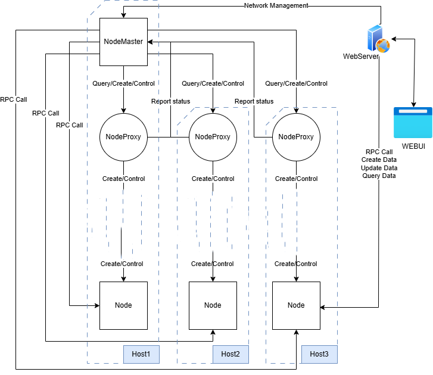

# 说明
### [IdentityOnChain使用说明](./md/IdentityOnChain使用说明.md)
### [js API 使用说明](./md/js_API使用说明.md)
### [ABCI-App接口说明](./md/ABCI-App接口说明.md)
### [chainnode 系统测试说明](./Doc/chainnode%20系统测试说明.docx)

# How to build setup file
1. build binary files for project chainnode, nodeGUI, abci-v2-identity-app.
2. download Cometbft binary file with correct version (v1 or v2) from [github](https://github.com/cometbft/cometbft/releases).
   - [v1.0.1](https://github.com/cometbft/cometbft/releases/download/v1.0.1/cometbft_1.0.1_windows_amd64.tar.gz)
   - [v2.0.0-rc no binary file](https://github.com/cometbft/cometbft/releases/tag/v2.0.0-rc1)
3. copy these new binary files to different directories based on files-tree.txt.
4. install inno
5. open setup.iss in inno directory and compile project.

## 流程图如下
